# 옆자리 — 공부·작업할 때 옆에 있어 주는 캐릭터

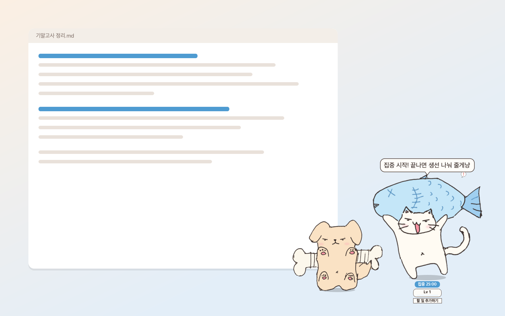

화면 한쪽에 작은 캐릭터가 앉아서 집중 시간을 재 주고, 칭찬해 주고, 쉬는 시간엔 같이 놀아요.
설치 파일만 받으면 바로 쓸 수 있어요. **체험판으로 시작**하고, 마음에 들면 라이선스 키를 넣어 정식판을 열면 돼요.

## 다운로드 (최신 버전)

| 운영체제 | 파일 | 지원 |
| --- | --- | --- |
| macOS | [**Yeopjari-mac.dmg**](https://github.com/sendtoyj00/yeopjari-download/releases/latest/download/Yeopjari-mac.dmg) | macOS 11 이상 · Apple Silicon(M1 이후) 맥 |
| Windows | [**Yeopjari-Setup.exe**](https://github.com/sendtoyj00/yeopjari-download/releases/latest/download/Yeopjari-Setup.exe) | Windows 10 · 11 (64비트) |

- 위 링크는 늘 최신 버전을 받아요. 버전 번호와 SHA256 체크섬은 [릴리스 페이지](https://github.com/sendtoyj00/yeopjari-download/releases/latest)에서 볼 수 있어요.
- 체험판과 정식판은 같은 설치 파일이에요. 정식판 라이선스 키는 판매처에서 살 수 있어요.

---

## 기능 소개

### 상황마다 바뀌는 표정
집중할 땐 진지하고, 쉬는 시간엔 웃고, 오래 자리를 비우면 꾸벅꾸벅 졸아요.
대기·집중·휴식·졸음·칭찬·춤·냠냠·잠듦, 모두 8가지예요.
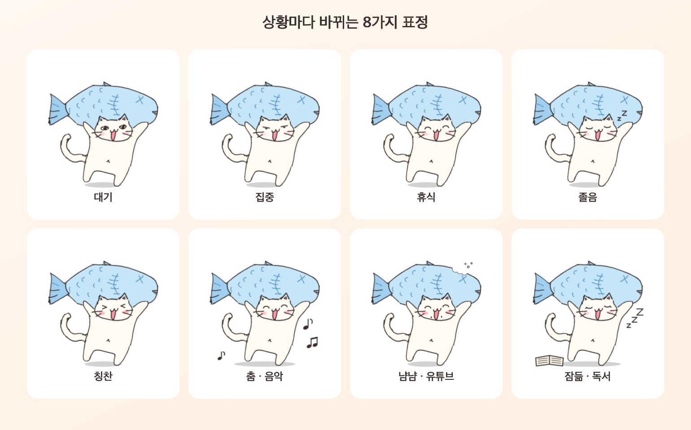

### 집중 타이머 · 할 일 · D-day
캐릭터를 더블클릭하거나 단축키(Ctrl+Alt+T, 맥은 Ctrl+Option+T)를 누르면 25분 집중이 시작돼요.
오늘 할 일과 시험 D-day를 캐릭터 옆에 두고 하나씩 지워 가요. 과목 태그를 달면 과목별 시간이 쌓여요.
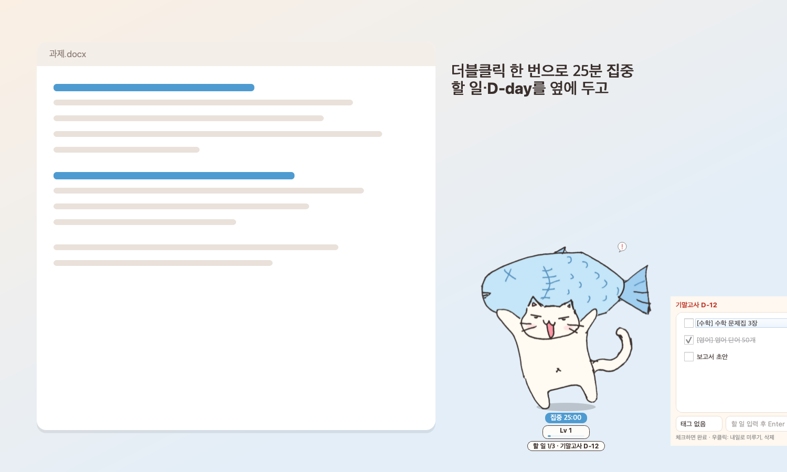

### 쉬는 시간엔 같이 놀아요
음악을 켜 두면 춤을 추고, 유튜브를 보면 생선을 냠냠 먹고, 책을 읽으면 옆에서 잠들어요. 집중하는 동안에는 방해하지 않아요.
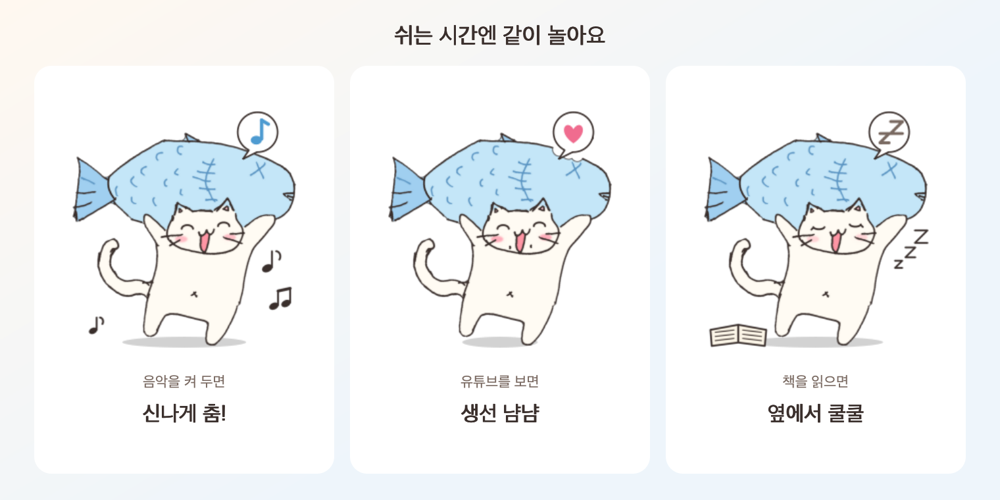

### 누르고 · 쓰다듬고 · 창 위에 올라서고
톡 누르면 통통 튀고, 마우스로 문지르면 쓰다듬어져요. 집중을 끝내면 하트가 퐁퐁 나와요.
끌고 다니면 대롱대롱 흔들리고, 다른 창 윗변에 올려 두면 그 창 위를 걸어 다니다가 창을 옮기면 따라와요.
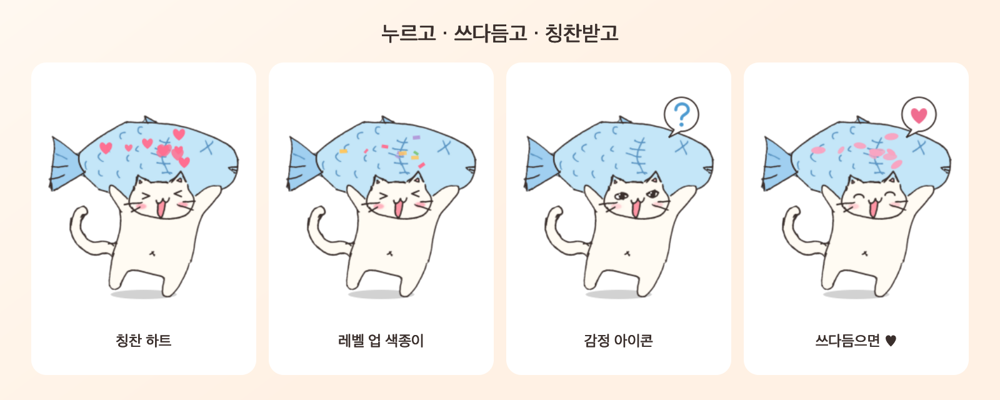

### 내 그림으로 캐릭터 만들기
좋아하는 그림을 상태별로 넣어서 나만의 캐릭터를 만들 수 있어요. 투명 배경 PNG를 추천해요.
넣은 그림의 상태만 바꾸는 것(옮기기·서로 바꾸기·다른 상태에도 쓰기)도 클릭 한 번이면 돼요. *(정식판: 상태별 8장 · 캐릭터 여러 명)*
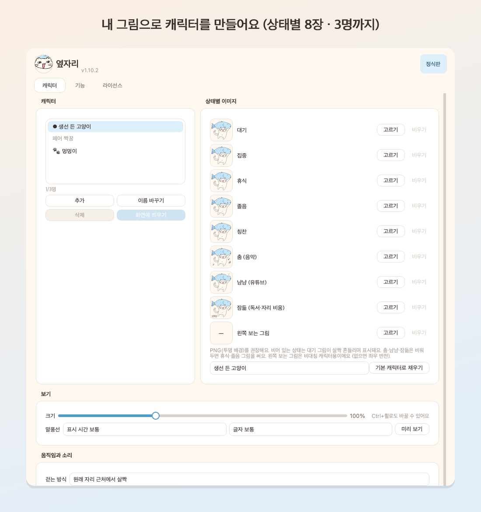

### 그룹 — 여러 캐릭터와 함께 *(정식판)*
뼈다귀를 멘 강아지 같은 멤버를 옆에 두면 함께 반응해요. 멤버마다 관계(친구·연인·라이벌·가족)와 성격을 정할 수 있어요.
관계에 따라 주고받는 대사가 달라지고, 멤버별 말풍선과 효과도 따로 정할 수 있어요.
자유롭게 배치해도 되고, 한 줄로 따라다니게 할 수도 있어요.
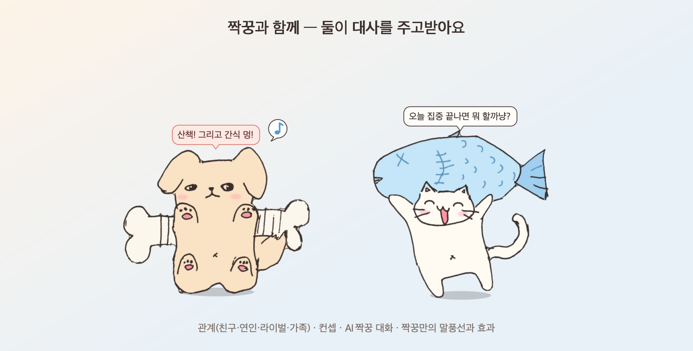

### 주간 리포트
한 주 동안 얼마나 했는지, 가장 많이 한 과목, 연속 기록을 카드 한 장으로 정리해 줘요. 일별 차트와 과목별 합계도 볼 수 있어요.
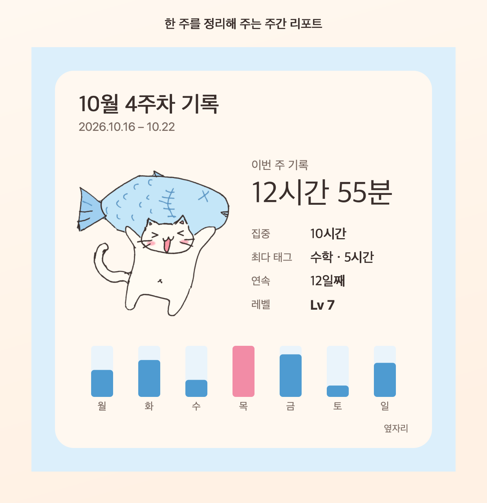

### AI 대사 *(정식판)*
AI가 적어 둔 성격과 말투에 맞춰 대사를 만들어 줘요. 쓸 수 있는 AI는 세 가지예요.
- **Gemini** (무료 키 가능)
- **Claude** (내 API 키)
- **로컬 AI** (Ollama): 키 없이 무료로 쓰고, 대사가 이 컴퓨터 안에서만 만들어져요.

만든 대사는 보관함에 쌓이고, 멤버끼리 주고받는 대화도 함께 만들 수 있어요.
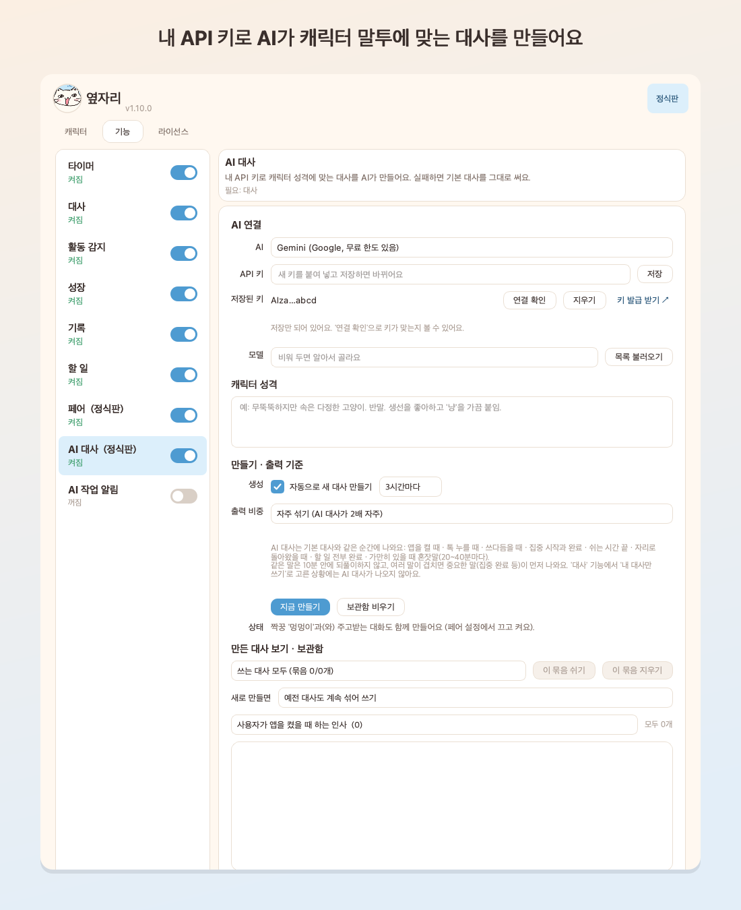

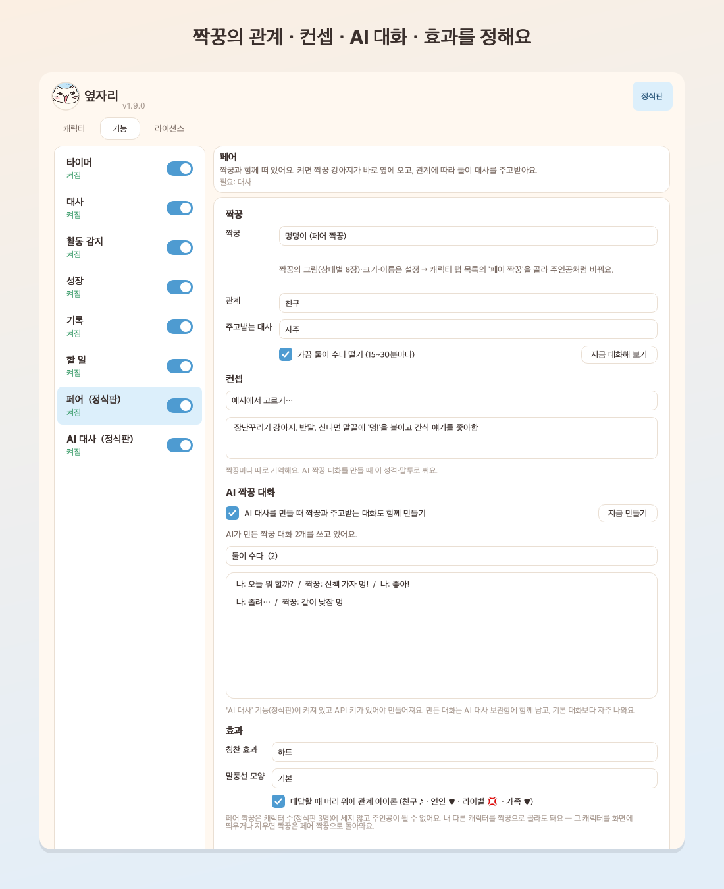

### 음악 따라 말하기
Spotify·Apple Music·브라우저 YouTube에서 듣는 곡을 알아채고, 캐릭터가 곡을 소개하거나 가사를 따라 불러요.
외국어 가사에는 한국어 번역을 작게 달아 줘요. *(설정 → 기능에서 켜기)*

### AI랑 같이 일할 때
Claude Code나 Codex에게 일을 맡겨 두면, 캐릭터가 작업마다 **시작 → 진행 중 → 완료**를 알려 줘요.
말풍선 위에 어떤 작업인지 적혀 있어서 여러 작업을 함께 해도 헷갈리지 않아요. 허락이 필요하면 '확인 필요'라고 바로 말해 줘요. *(설정 → 기능에서 켜기)*
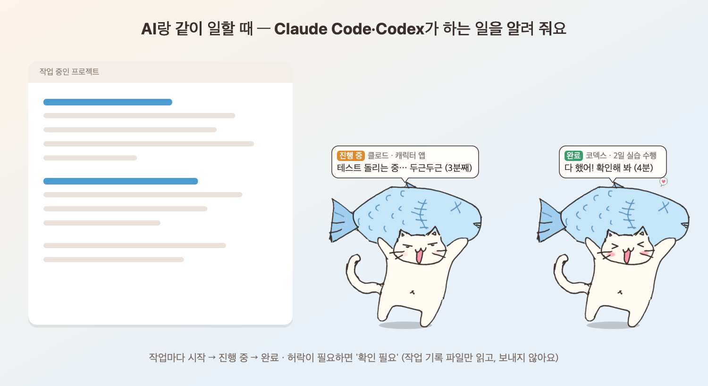

---

## 체험판과 정식판

| | 체험판 | 정식판 |
| --- | --- | --- |
| 캐릭터 | 1명 | 여러 명 |
| 상태별 그림 | 1장 | 8장 (춤·냠냠·잠듦 포함) + 왼쪽 보는 그림 |
| 말투 · 대사 편집 | 다정 1종 | 3종 + 캐릭터별 대사 편집 |
| 레벨 | 10까지 | 무제한 |
| 기록 보기 | 최근 7일 | 전체 |
| 주간 리포트 | 워터마크 | 깔끔하게 |
| 작업 앱 구분 | — | ○ |
| 할 일 태그 · D-day | 3개 · 1개 | 무제한 |
| 그룹 · AI 대사 · 가사 AI 번역 | — | ○ |
| 타이머 · 쉬는 시간 놀이 · 음악 따라 말하기 · AI 작업 알림 | ○ | ○ |

체험판에서 쌓은 기록과 경험치는 정식판이 되어도 그대로 이어져요.

---

## 설치

**macOS**
1. `Yeopjari-mac.dmg`를 열고 **옆자리**를 **응용 프로그램** 폴더로 끌어다 놓아요.
2. 처음 열 때 "확인되지 않은 개발자" 안내가 뜨면, 응용 프로그램 폴더에서 옆자리를 **우클릭 → 열기 → 열기**로 열어요.
   (또는 시스템 설정 → 개인정보 보호 및 보안 → 아래쪽의 **그래도 열기**)
3. 화면 위 메뉴 막대의 고양이 아이콘에서 설정·숨기기·종료를 할 수 있어요.

**Windows**
1. `Yeopjari-Setup.exe`를 실행해요.
2. "Windows의 PC 보호" 창이 뜨면 **추가 정보 → 실행**을 눌러요.
3. 작업 표시줄 오른쪽 아래의 고양이 아이콘에서 설정·숨기기·종료를 할 수 있어요.

**업데이트**: 새 버전을 받아 같은 방법으로 덮어 설치하면 돼요. 캐릭터·기록·라이선스는 그대로 남아요.

---

## Q&A

<b>라이선스 키는 어디에 넣나요?</b>

캐릭터를 우클릭하거나(또는 메뉴 막대·작업 표시줄 아이콘) **설정 → 라이선스** 탭을 열어요. 키를 붙여 넣고 **적용**을 누르면 바로 정식판으로 바뀌어요.

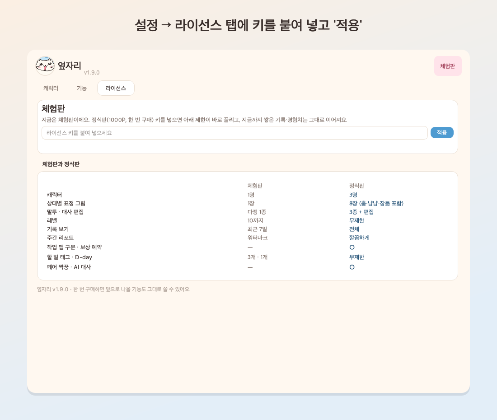

"키가 올바르지 않아요"가 뜨면 앞뒤 공백 없이 다시 붙여 넣어 보세요. "사용이 중지된 키"가 뜨면 구매처에 문의해 주세요.

<b>AI 대사는 어떻게 켜나요? 돈이 드나요?</b>

**설정 → 기능 → AI 대사**를 켜고 AI를 고른 다음 API 키를 저장해요. 저장하면 바로 연결을 확인해요.

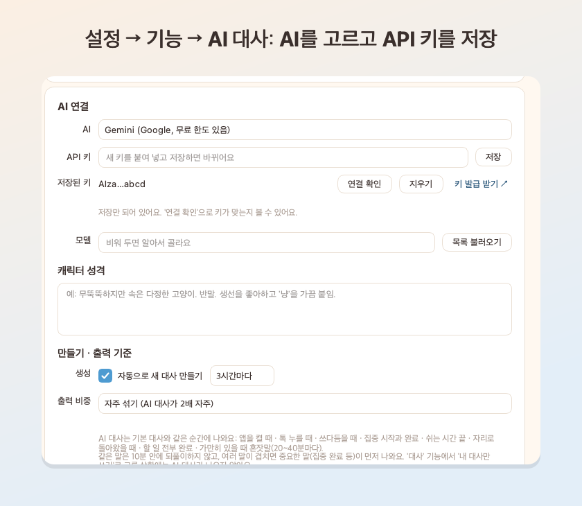

- **Gemini**: [Google AI Studio](https://aistudio.google.com/apikey)에서 키를 받아요. 무료 한도 안에서는 무료예요.
- **Claude**: [Anthropic 콘솔](https://console.anthropic.com/settings/keys)에서 키를 받아요. 사용한 만큼 키 주인에게 요금이 나가요.
- **로컬 AI (Ollama)**: 키가 필요 없고 무료예요. 설정에서 'Ollama 받기'를 눌러 설치하고, 추천 모델을 골라 '받기'를 누르면 돼요. 메모리 8GB 이상을 추천하고, 그래픽 가속이 없으면 한 묶음에 몇 분 걸릴 수 있어요.
- 키는 이 컴퓨터의 키체인(Windows는 자격 증명 관리자)에만 저장돼요.
- AI에게 보내는 건 캐릭터 이름, 적어 둔 성격·말투, 오늘 집중·활동 시간과 연속 일수예요. 키 입력 내용·화면·할 일 내용은 보내지 않아요.
- AI가 실패해도 기본 대사로 계속 말해요.

<b>쉬는 시간에 춤·냠냠·잠을 안 하게 하고 싶어요</b>

**설정 → 기능 → 활동 감지 → 쉬는 시간 놀이**에서 전부 끄거나 종류별로 끌 수 있어요.

음악 앱이 켜져 있으면 일시정지 중이어도 춤을 춰요.
맥에서 유튜브를 알아채려면 처음 한 번 뜨는 "옆자리가 Chrome(또는 Safari)을 제어하려고 합니다" 창에서 **허용**을 눌러 주세요. Firefox에서는 알아챌 수 없어요.

<b>그룹 멤버의 그림이나 이름을 바꾸고 싶어요</b>

**설정 → 캐릭터** 목록에서 멤버를 고르면 주인공처럼 상태별 그림·크기·이름을 바꿀 수 있어요.
관계·성격·대사 빈도·효과는 **설정 → 기능 → 그룹**에서 정해요.

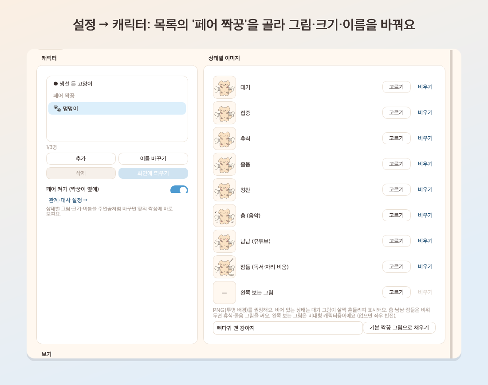

<b>인텔 맥에서 열리지 않아요</b>

지금은 애플 실리콘(M1 이후) 맥만 지원해요. 인텔 맥 지원은 준비 중이에요.

<b>맥에서 "키체인 암호" 창이 떠요</b>

AI 대사용 API 키를 키체인에서 꺼낼 때 macOS가 확인하는 창이에요. 맥 로그인 암호를 넣고 **항상 허용**을 누르면 돼요.
암호는 옆자리가 받지 않고 macOS가 직접 받아요.

<b>캐릭터가 사라졌어요 / 화면 밖으로 나갔어요</b>

메뉴 막대(맥)나 작업 표시줄(Windows)의 아이콘에서 **캐릭터 보이기**를 눌러요.
모니터 구성이 바뀌어 화면 밖에 있었다면 다시 켤 때 기본 자리로 돌아와요.

<b>무엇을 보고, 무엇을 저장하나요? (개인정보)</b>

- **활동 감지**: 다음만 확인해요. **키 입력 내용과 화면은 보지 않아요.**
  - 마지막 입력 후 지난 시간
  - 맨 앞 프로그램 이름 (켠 경우)
  - 실행 중인 음악 앱 이름
  - 맨 앞 브라우저 탭이 유튜브인지
- **AI 작업 알림** (켠 경우): Claude Code·Codex가 이 컴퓨터에 남기는 작업 기록 파일에서 새 줄만 읽어요. 말풍선에는 작업 종류와 파일 이름만 보여요. 읽은 내용은 저장하거나 보내지 않아요.
- **기록**: 이 컴퓨터에만 저장돼요. 맥은 `~/Library/Application Support/Yeopjari`, Windows는 `%APPDATA%\Yeopjari`예요.
- **인터넷을 쓰는 경우**:
  - 늘 쓰는 것: 하루 한 번 라이선스 차단 목록(이 저장소의 `blocklist.json`)을 받아요. 보내는 정보는 없어요.
  - AI 대사를 켰을 때: 고른 AI에 대사를 요청해요. 로컬 AI는 이 컴퓨터 안에서만 돌아요.
  - 음악 따라 말하기를 켰을 때: 가사 사이트(lrclib.net 등)에 곡 정보를 보내고, 번역 서비스에 외국어 가사 줄을 보내요.

<b>문제가 생기면 어디에 알리나요?</b>

구매처 문의 창구로 알려 주세요. 아래를 함께 보내 주시면 빨리 해결할 수 있어요.
- 옆자리 버전 (설정 창 위쪽), 운영체제
- 어떤 상황에서 생겼는지
- 로그 파일: 맥 `~/Library/Application Support/Yeopjari/logs/app.log`, Windows `%APPDATA%\Yeopjari\logs\app.log`

---

이 저장소에는 설치 파일과 소개 자료만 있어요. 프로그램 소스 코드는 공개하지 않아요.
라이선스 구매·환불·문의는 판매처로 연락해 주세요.
