# 옆자리 — 공부·작업할 때 옆에 있어 주는 캐릭터

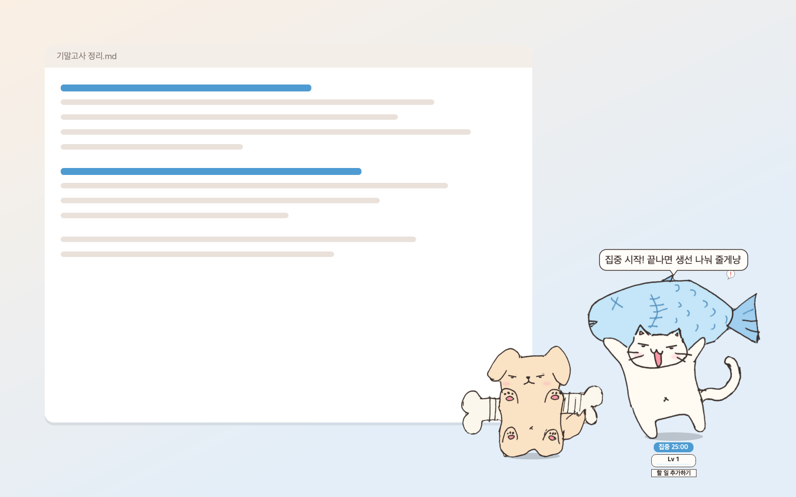

화면 한쪽에 작은 캐릭터가 함께 앉아 집중 시간을 재 주고, 칭찬해 주고, 쉬는 시간엔 같이 놀아요.
설치 파일만 받으면 바로 쓸 수 있고, **체험판으로 시작**해서 마음에 들면 라이선스 키로 정식판을 열 수 있어요.

## 다운로드

| 운영체제 | 파일 | 지원 |
| --- | --- | --- |
| macOS | [**Yeopjari-mac.dmg**](https://github.com/sendtoyj00/yeopjari-download/releases/latest/download/Yeopjari-mac.dmg) | macOS 11 이상 · Apple Silicon(M1 이후) 맥 (인텔 맥은 아직 지원하지 않아요) |
| Windows | [**Yeopjari-Setup.exe**](https://github.com/sendtoyj00/yeopjari-download/releases/latest/download/Yeopjari-Setup.exe) | Windows 10 · 11 (64비트) |

지난 버전과 바뀐 점은 [릴리스 페이지](https://github.com/sendtoyj00/yeopjari-download/releases)에서 볼 수 있어요.
정식판 라이선스 키는 판매처에서 구매할 수 있어요.

---

## 기능 소개

### 상황마다 바뀌는 8가지 표정
집중할 땐 진지하게, 쉬는 시간엔 웃고, 오래 자리를 비우면 꾸벅꾸벅 졸아요.
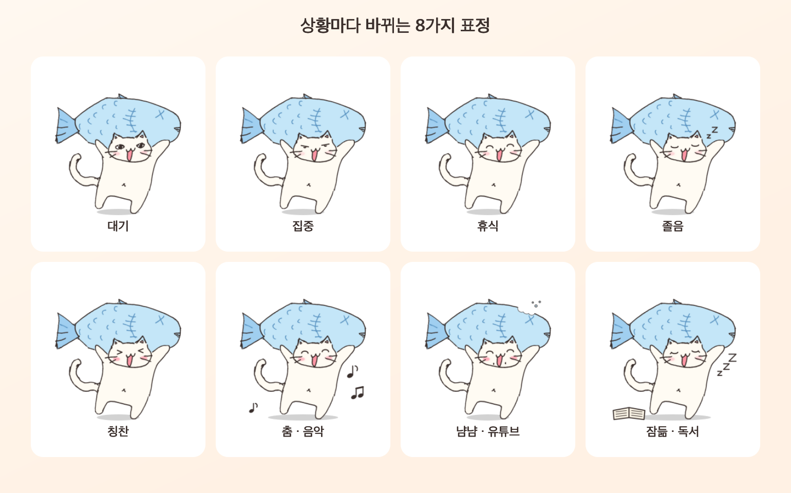

### 짝꿍과 함께
뼈다귀를 멘 강아지 짝꿍이 옆에 서서 함께 반응해요. 관계(친구·연인·라이벌·가족)에 따라 둘이 주고받는 대사가 달라지고,
짝꿍의 컨셉·말풍선·효과도 따로 정할 수 있어요. *(정식판)*
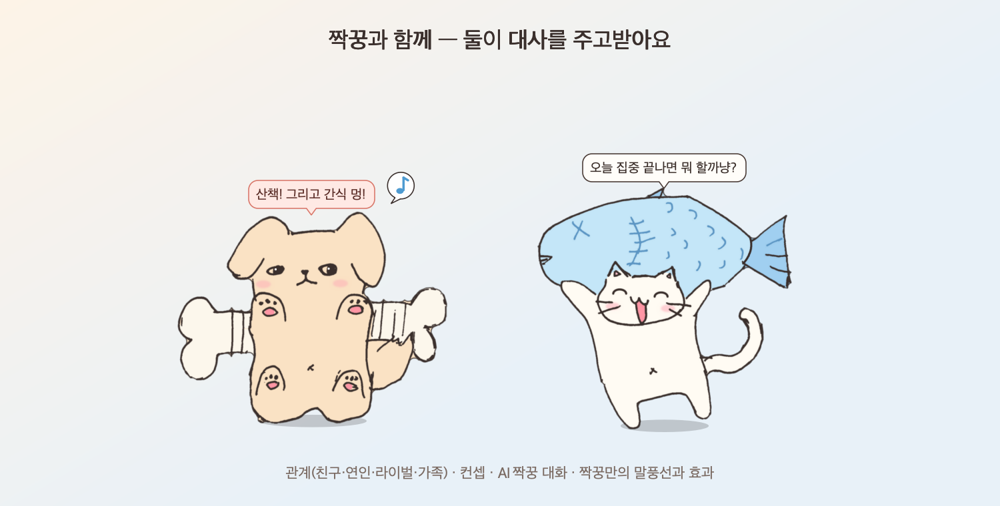

### 쉬는 시간엔 같이 놀아요
음악을 켜 두면 춤을 추고, 유튜브를 보면 생선을 냠냠, 책을 읽으면 옆에서 잠들어요. 집중하는 동안에는 방해하지 않아요.
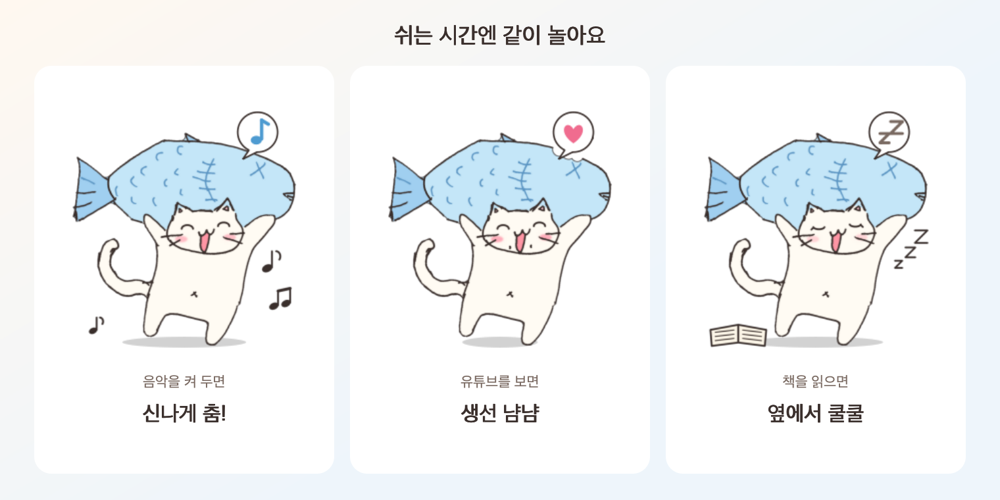

### 집중 타이머 · 할 일 · D-day
캐릭터를 더블클릭하면 25분 집중이 시작돼요. 오늘 할 일과 시험 D-day를 캐릭터 옆에 두고 하나씩 지워 가요.
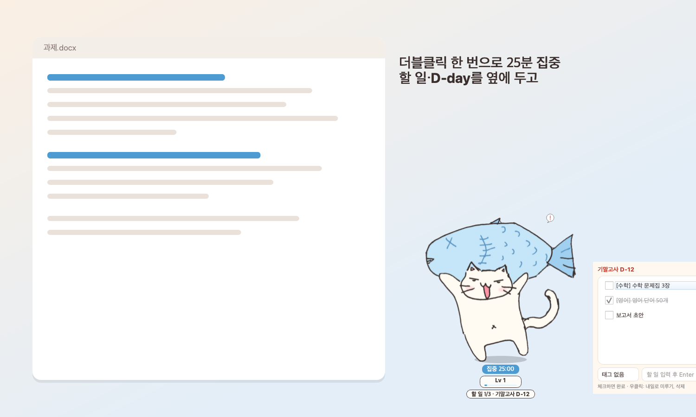

### 주간 리포트
한 주 동안 얼마나 했는지, 가장 많이 한 과목, 연속 기록을 카드 한 장으로 정리해 줘요.
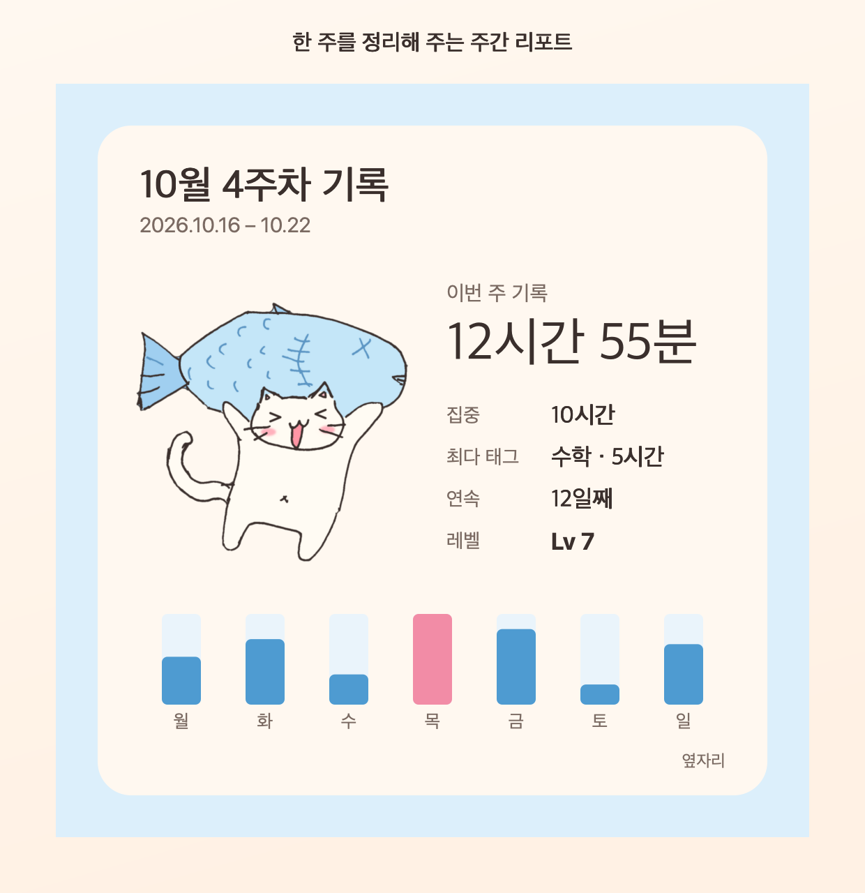

### 누르고 · 쓰다듬고 · 칭찬받고
톡 누르면 통통 튀고, 마우스로 문지르면 쓰다듬기, 집중을 끝내면 하트가 퐁퐁. 끌고 다니면 대롱대롱 흔들려요.
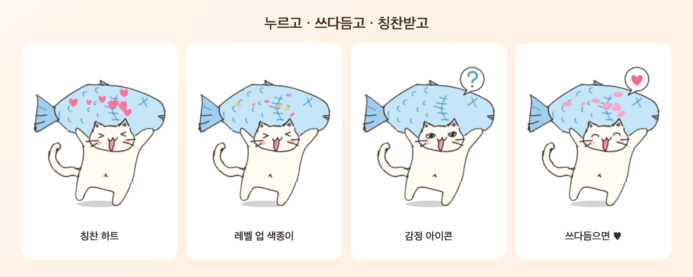

### 내 그림으로 캐릭터 만들기
좋아하는 그림을 상태별로 넣어 나만의 캐릭터를 만들 수 있어요 (투명 배경 PNG 추천). *(정식판: 8장 · 3명까지)*
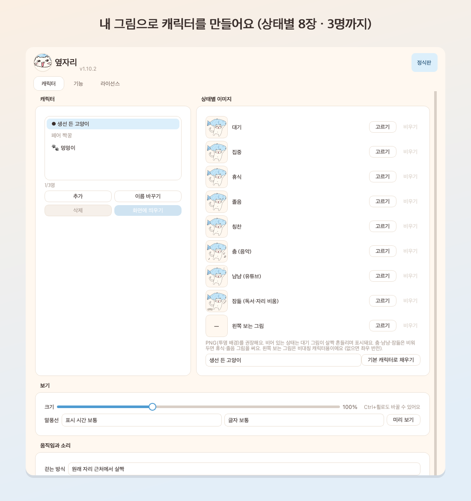

### AI 대사
내 API 키(Google Gemini 무료 키 또는 Claude)로 적어 둔 성격·말투에 맞는 대사를 AI가 만들어 줘요.
만든 대사는 보관함에 쌓이고, 짝꿍과 주고받는 대화도 함께 만들 수 있어요. *(정식판)*
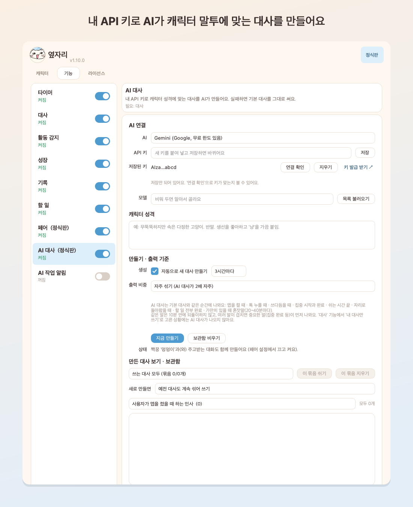

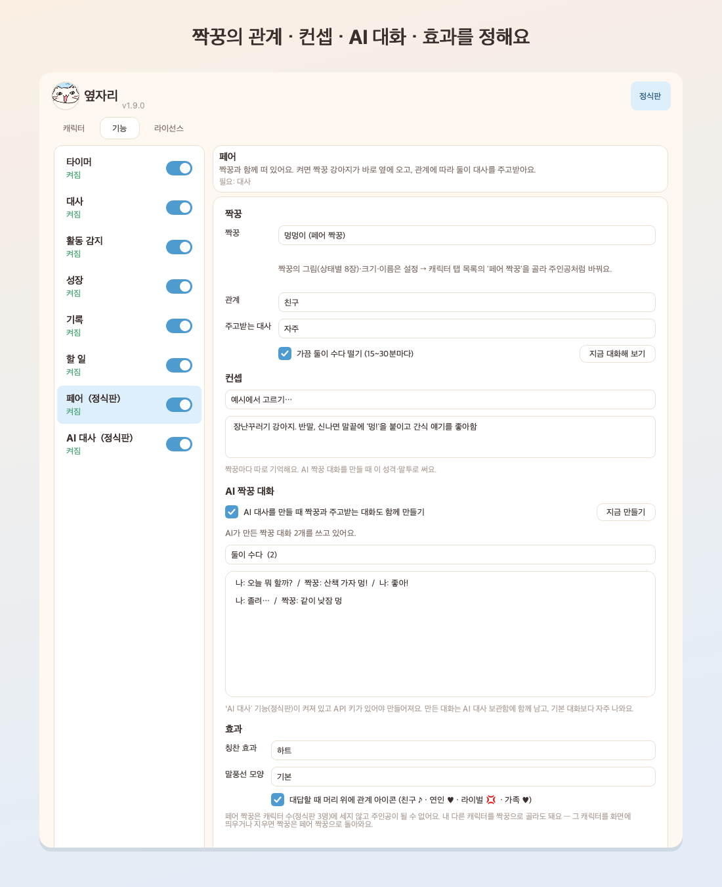

---

## 체험판과 정식판

| | 체험판 | 정식판 |
| --- | --- | --- |
| 캐릭터 | 1명 | 3명 |
| 상태별 표정 그림 | 1장 | 8장 (춤·냠냠·잠듦 포함) |
| 말투 · 대사 편집 | 다정 1종 | 3종 + 편집 |
| 레벨 | 10까지 | 무제한 |
| 기록 보기 | 최근 7일 | 전체 |
| 주간 리포트 | 워터마크 | 깔끔하게 |
| 작업 앱 구분 · 보상 예약 | — | ○ |
| 할 일 태그 · D-day | 3개 · 1개 | 무제한 |
| 페어 짝꿍 · AI 대사 | — | ○ |

체험판에서 쌓은 기록·경험치는 정식판이 되어도 그대로 이어져요.

---

## 설치

**macOS**
1. `Yeopjari-mac.dmg`를 열고 **옆자리**를 **응용 프로그램** 폴더로 끌어다 놓아요.
2. 처음 열 때 "확인되지 않은 개발자" 안내가 뜨면: 응용 프로그램 폴더에서 옆자리를 **우클릭 → 열기 → 열기**.
   (또는 시스템 설정 → 개인정보 보호 및 보안 → 아래쪽의 **그래도 열기**)
3. 화면 위 메뉴 막대의 고양이 아이콘에서 설정·숨기기·종료를 할 수 있어요.

**Windows**
1. `Yeopjari-Setup.exe`를 실행해요.
2. "Windows의 PC 보호" 창이 뜨면 **추가 정보 → 실행**.
3. 작업 표시줄 오른쪽 아래의 고양이 아이콘에서 설정·숨기기·종료를 할 수 있어요.

**업데이트**: 새 버전을 받아 같은 방법으로 덮어 설치하면 돼요. 캐릭터·기록·라이선스는 그대로 남아요.

---

## Q&A

<b>라이선스 키는 어디에 넣나요?</b>

캐릭터를 우클릭(또는 메뉴 막대·작업 표시줄 아이콘) → **설정 → 라이선스** 탭에 키를 붙여 넣고 **적용**을 눌러요. 바로 정식판으로 바뀌어요.

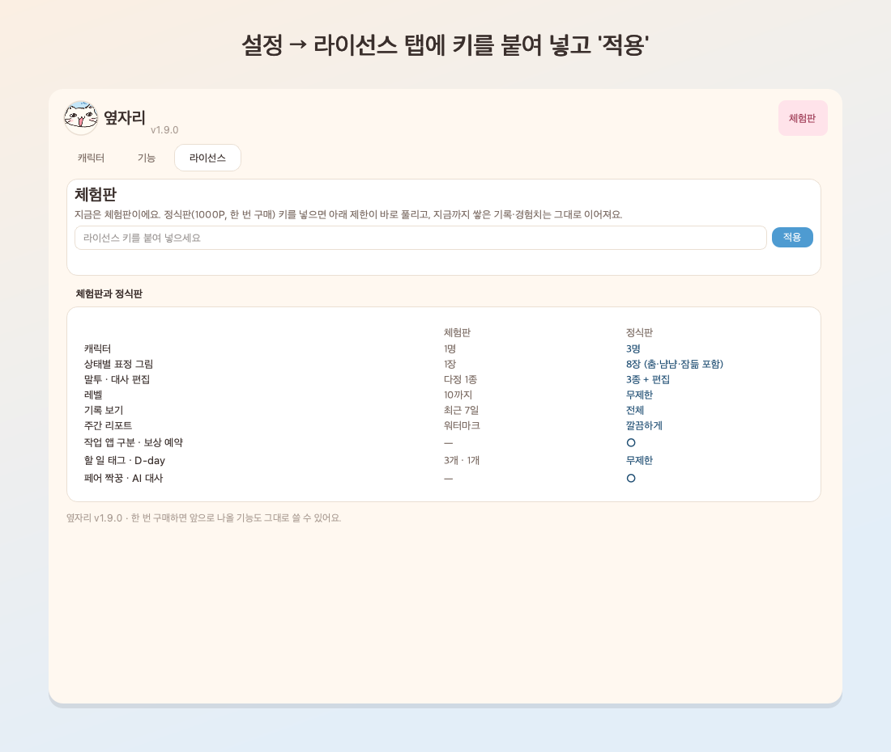

"키가 올바르지 않아요"가 뜨면 앞뒤 공백 없이 다시 붙여 넣어 보세요. "사용이 중지된 키"가 뜨면 구매처에 문의해 주세요.

<b>AI 대사는 어떻게 켜나요? 돈이 드나요?</b>

**설정 → 기능 → AI 대사**를 켜고, AI를 고른 뒤 API 키를 저장해요. 저장하면 바로 연결을 확인해요.

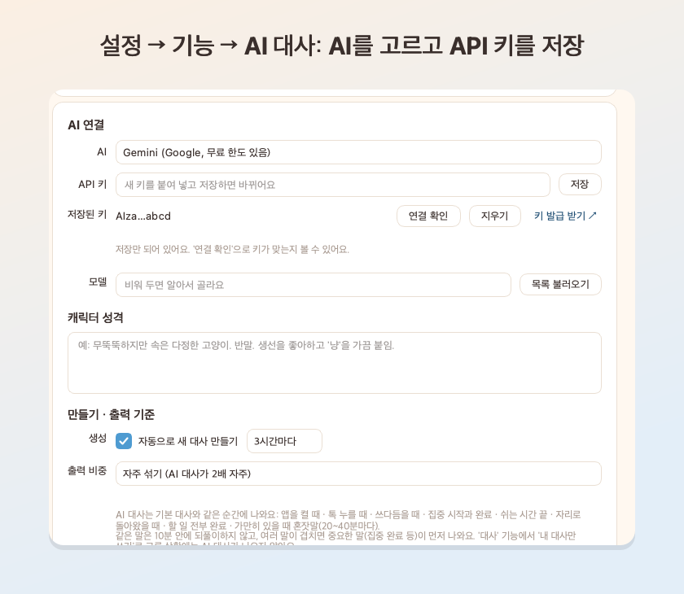

- **Gemini (추천)**: [Google AI Studio](https://aistudio.google.com/apikey)에서 무료 키를 받을 수 있어요 (무료 한도 안에서 무료).
- **Claude**: [Anthropic 콘솔](https://console.anthropic.com/settings/keys)에서 키를 받아요 (사용한 만큼 키 주인에게 요금).
- 키는 이 컴퓨터의 키체인(Windows 자격 증명 관리자)에만 저장돼요.
- 보내는 것: 캐릭터 이름, 적어 둔 성격·말투, 오늘 집중·활동 시간과 연속 일수. 키 입력 내용·화면·할 일 내용은 보내지 않아요.
- AI가 실패해도 기본 대사로 계속 말해요.

<b>쉬는 시간에 춤·냠냠·잠을 안 하게 하고 싶어요</b>

**설정 → 기능 → 활동 감지 → 쉬는 시간 놀이**에서 전부 또는 종류별로 끌 수 있어요.

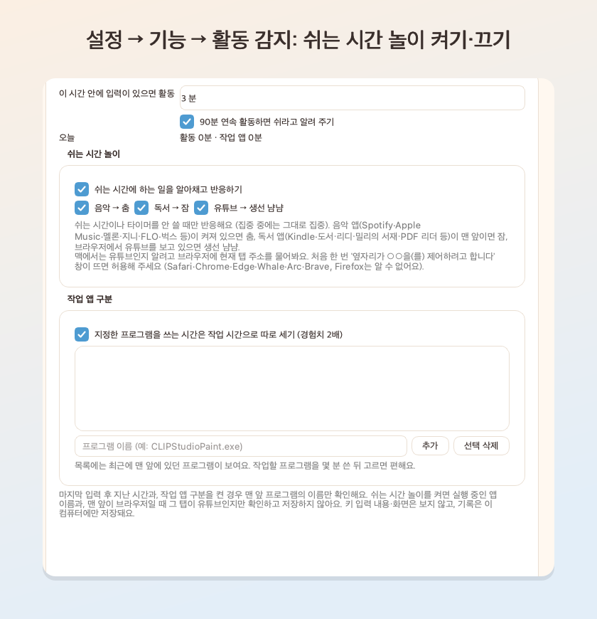

음악 앱이 켜져 있으면(일시정지 중이어도) 춤을 춰요. 맥에서 유튜브를 알아채려면 처음 한 번 "옆자리가 Chrome(또는 Safari)을 제어하려고 합니다" 창에서 **허용**해 주세요 (Firefox는 알 수 없어요).

<b>짝꿍 그림이나 이름을 바꾸고 싶어요</b>

**설정 → 캐릭터** 목록 아래의 **페어 짝꿍**을 고르면, 주인공처럼 상태별 그림·크기·이름을 바꿀 수 있어요.
관계·대사 빈도·컨셉·효과는 **설정 → 기능 → 페어**에서 정해요.

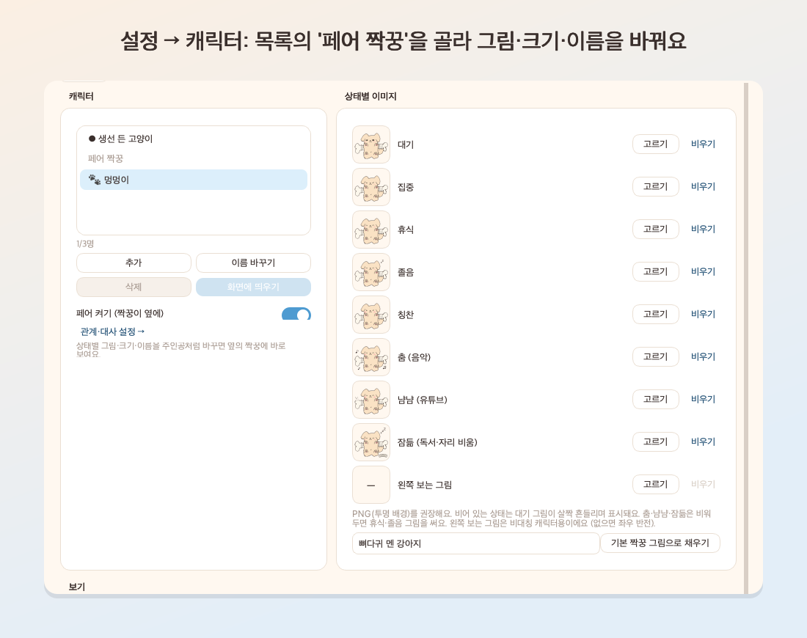

<b>인텔 맥에서 열리지 않아요</b>

지금은 애플 실리콘(M1 이후) 맥만 지원해요. 인텔 맥 지원은 준비 중이에요.

<b>맥에서 "키체인 암호" 창이 떠요</b>

AI 대사용 API 키를 키체인에서 꺼낼 때 macOS가 확인하는 창이에요. 맥 로그인 암호를 넣고 **항상 허용**을 누르면 돼요.
암호는 옆자리가 아니라 macOS가 직접 받아요.

<b>캐릭터가 사라졌어요 / 화면 밖으로 나갔어요</b>

메뉴 막대(맥) 또는 작업 표시줄(Windows)의 아이콘 → **캐릭터 보이기**를 눌러요.
모니터 구성이 바뀌어 화면 밖에 있으면 다시 켤 때 기본 자리로 돌아와요.

<b>무엇을 보고, 무엇을 저장하나요? (개인정보)</b>

- 활동 감지: 마지막 입력 후 지난 시간, (켠 경우) 맨 앞 프로그램 이름, 실행 중인 음악 앱 이름, 맨 앞 브라우저 탭이 유튜브인지만 확인해요. **키 입력 내용·화면은 보지 않아요.**
- 기록은 이 컴퓨터에만 저장돼요 (맥 `~/Library/Application Support/Yeopjari`, Windows `%APPDATA%\Yeopjari`).
- 인터넷 사용: AI 대사를 켰을 때 AI 요청, 그리고 하루 한 번 라이선스 차단 목록(이 저장소의 `blocklist.json`)을 받는 것뿐이에요. 보내는 정보는 없어요.

<b>문제가 생기면 어디에 알리나요?</b>

구매처 문의 창구로 알려 주세요. 아래를 함께 보내 주시면 빨리 해결할 수 있어요.
- 옆자리 버전 (설정 창 위쪽), 운영체제
- 어떤 상황에서 생겼는지
- 로그 파일: 맥 `~/Library/Application Support/Yeopjari/logs/app.log`, Windows `%APPDATA%\Yeopjari\logs\app.log`

---

이 저장소에는 설치 파일과 소개 자료만 있어요. 라이선스 구매·환불·문의는 판매처로 연락해 주세요.
