# 옆자리 — 공부·작업할 때 옆에 있어 주는 캐릭터

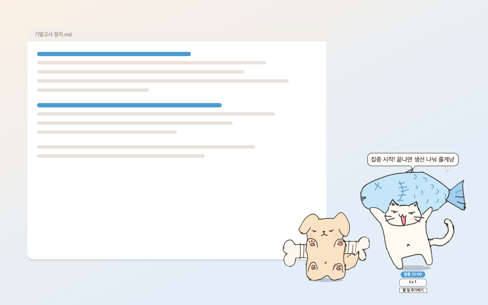

**옆자리**는 컴퓨터 화면 구석에 작은 캐릭터를 띄워 주는 프로그램이에요.
캐릭터가 공부 시간을 재 주고, 끝나면 칭찬해 주고, 쉬는 시간엔 같이 놀아요.

- 돈을 내지 않아도 **체험판**으로 바로 쓸 수 있어요.
- 회원 가입이 없어요. 파일 하나만 받아서 설치하면 끝이에요.
- 컴퓨터를 잘 몰라도 괜찮아요. 아래 **3단계**만 차례로 따라 하세요. 5분이면 돼요.

---

## 3단계로 시작하기

### 1단계. 파일 받기

먼저 내 컴퓨터가 어떤 종류인지 확인해요.

| 내 컴퓨터 | 알아보는 법 | 받을 파일 (파란 글씨를 누르세요) |
| --- | --- | --- |
| **윈도우** (삼성·LG 등 대부분의 컴퓨터) | 화면 맨 아래에 **창문 모양(⊞)** 버튼이 있어요 | [**윈도우용 받기**](https://github.com/sendtoyj00/yeopjari-download/releases/latest/download/Yeopjari-Setup.exe) |
| **맥** (애플 컴퓨터) | 화면 왼쪽 맨 위에 **사과 모양**이 있어요 | [**맥용 받기**](https://github.com/sendtoyj00/yeopjari-download/releases/latest/download/Yeopjari-mac.dmg) |

파란 글씨를 누르면 바로 내려받기가 시작돼요. 받은 파일은 보통 **다운로드** 폴더에 들어 있어요.

> **쓸 수 있는 컴퓨터**
> - 윈도우: Windows 10 또는 11
> - 맥: 2020년 말 이후에 나온 맥 (M1·M2·M3·M4 칩)
>   확인하는 법: 왼쪽 위 **사과 모양 → 이 Mac에 관하여**를 눌러요. **칩**에 `Apple M1`처럼 적혀 있으면 돼요. `Intel`이라고 적혀 있으면 아직 쓸 수 없어요.

<b>'AI 없는 판'도 있어요 (눌러서 펼치기)</b>

옆자리는 두 가지로 나와요. 캐릭터가 하는 말을 **AI(인공지능)가 지어 주는 기능**이 들어 있느냐만 달라요.

| | AI 있는 판 (위 표의 파일) | AI 없는 판 |
| --- | --- | --- |
| 캐릭터가 하는 말 | 기본 대사 + 내가 쓴 대사 + **AI가 지은 대사** | 기본 대사 + 내가 쓴 대사 |
| 그 밖의 기능 | 모두 같아요 | 모두 같아요 |
| 받기 | 위 표에서 받아요 | [윈도우용](https://github.com/sendtoyj00/yeopjari-download/releases/latest/download/Yeopjari-Setup-noai.exe) · [맥용](https://github.com/sendtoyj00/yeopjari-download/releases/latest/download/Yeopjari-mac-noai.dmg) |

- **잘 모르겠으면 위 표의 파일(AI 있는 판)을 받으세요.** AI 기능은 내가 직접 켜기 전에는 작동하지 않아요.
- AI를 쓸 생각이 전혀 없고 화면이 단순한 게 좋으면 AI 없는 판을 받으세요.
- 나중에 다른 판으로 바꿔 설치해도 캐릭터와 기록은 그대로 남아요. 정식판 키도 두 판에서 똑같이 쓸 수 있어요.

### 2단계. 설치하기

#### 윈도우

1. **다운로드** 폴더에서 `Yeopjari-Setup` 파일을 **더블클릭**해요. (마우스 왼쪽 버튼을 빠르게 두 번)
2. 파란색 **"Windows의 PC 보호"** 창이 뜨면 → 글자 **추가 정보**를 누르고 → 아래에 생기는 **실행** 버튼을 눌러요.
3. 설치 창이 나오면 **다음(Next)** → **설치(Install)** → **마침(Finish)**을 차례로 눌러요.
4. 화면에 캐릭터가 나타나면 성공이에요. 다음부터는 **시작 메뉴**(창문 모양 버튼)에서 **옆자리**를 눌러 켜요.

#### 맥

1. **다운로드** 폴더에서 `Yeopjari-mac.dmg` 파일을 **더블클릭**해요.
2. 창이 하나 열려요. 그 안의 **Yeopjari**(옆자리) 그림을 옆에 있는 **Applications**(응용 프로그램) 폴더 그림 위로 **끌어다 놓아요**. (누른 채로 옮긴 뒤 손을 떼요)
3. **응용 프로그램** 폴더를 열고 **Yeopjari**를 더블클릭해요.
   응용 프로그램 폴더는 화면 아래 줄의 **웃는 얼굴 아이콘(Finder)** 을 누르면 왼쪽 목록에 있어요.
4. "열 수 없습니다" 같은 경고 창이 뜨면 아래 순서대로 해요. **처음 한 번만** 하면 돼요.
   1. 경고 창은 **완료**를 눌러 닫아요. (**휴지통으로 이동**은 누르지 마세요)
   2. 왼쪽 위 **사과 모양 → 시스템 설정 → 개인정보 보호 및 보안**으로 가요.
   3. 화면을 아래로 내리면 Yeopjari(옆자리)가 차단되었다는 줄이 있어요. 그 옆의 **그래도 열기**를 눌러요.
   4. 맥을 켤 때 쓰는 암호를 넣으면 옆자리가 열려요.
5. 화면에 캐릭터가 나타나면 성공이에요.

> 예전 macOS에서는 4번 대신, 응용 프로그램 폴더의 Yeopjari를 **마우스 오른쪽 버튼으로 누르고 → 열기 → 열기**를 눌러도 돼요.

<b>경고 창이 왜 뜨나요? 위험한 건가요?</b>

위험해서 뜨는 게 아니에요. 윈도우와 맥은 큰 회사가 만들어 따로 인증받은 프로그램이 아니면 처음 열 때 한 번씩 물어봐요. 옆자리는 그 인증을 받지 않은 프로그램이라서 안내가 나와요.
다만 **꼭 이 페이지에서 받은 파일만** 이렇게 열어 주세요.

### 3단계. 써 보기

캐릭터가 화면에 나타났나요? 이제 이것만 알면 돼요.

| 하고 싶은 것 | 이렇게 해요 |
| --- | --- |
| **25분 집중 시작하기** | 캐릭터를 **더블클릭** |
| 캐릭터 자리 옮기기 | 캐릭터를 누른 채로 **끌어서** 옮기기 |
| 캐릭터에게 말 걸기 | 캐릭터를 **한 번** 누르기 |
| 쓰다듬기 | 캐릭터 위에서 마우스를 **좌우로 문지르기** |
| **설정 열기** | 캐릭터에 마우스를 올리면 오른쪽 위에 나오는 **⚙(톱니바퀴)** 누르기 |
| 메뉴 보기 | 캐릭터를 **마우스 오른쪽 버튼**으로 누르기 (맥 트랙패드는 두 손가락으로 누르기) |
| 캐릭터 숨기기 · 프로그램 끄기 | **고양이 아이콘**을 누르고 **캐릭터 숨기기** 또는 **종료** |

**고양이 아이콘은 어디 있나요?**
- 윈도우: 화면 **오른쪽 맨 아래**, 시계 옆에 있어요. 안 보이면 그 근처의 **∧** 모양을 눌러 보세요.
- 맥: 화면 **맨 위 오른쪽**, 시계 근처에 있어요.

처음 켜면 설정 창 위쪽에 **시작하기** 안내가 보여요. 적힌 대로 하나씩 해 보면 체크가 붙어요. 다 봤으면 **닫기**를 누르세요.

더 자세한 사용법은 📖 **[사용 설명서](MANUAL.md)**에 순서대로 적어 두었어요.

---

## 이런 걸 할 수 있어요

### 상황마다 표정이 바뀌어요
집중할 땐 진지하고, 쉬는 시간엔 웃고, 자리를 오래 비우면 꾸벅꾸벅 졸아요. 내가 따로 누르지 않아도 저절로 바뀌어요.
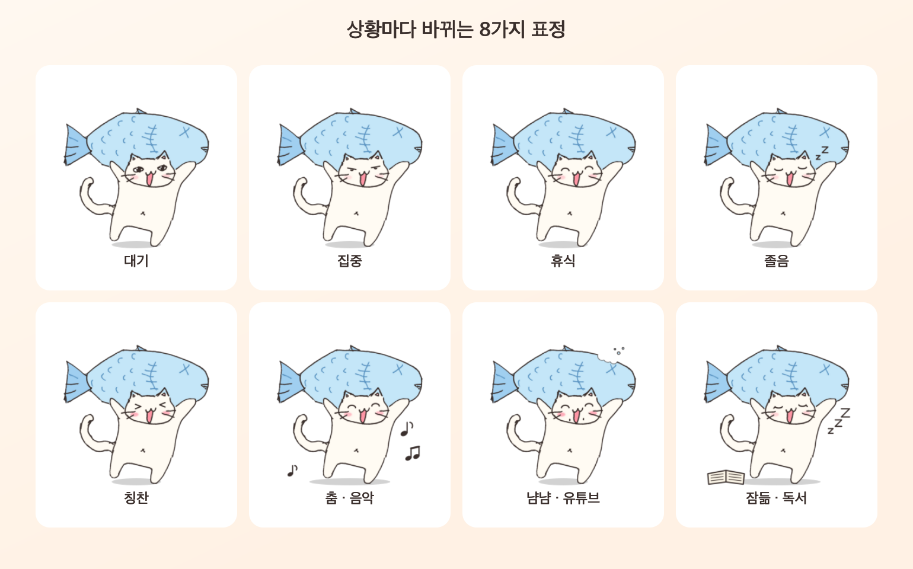

### 공부 시간을 재 줘요 (타이머 · 할 일 · D-day)
캐릭터를 더블클릭하면 25분 집중이 시작돼요. 끝나면 캐릭터가 칭찬해 줘요.
오늘 할 일과 시험까지 남은 날(D-day)을 캐릭터 옆에 적어 두고 하나씩 지워 갈 수 있어요.
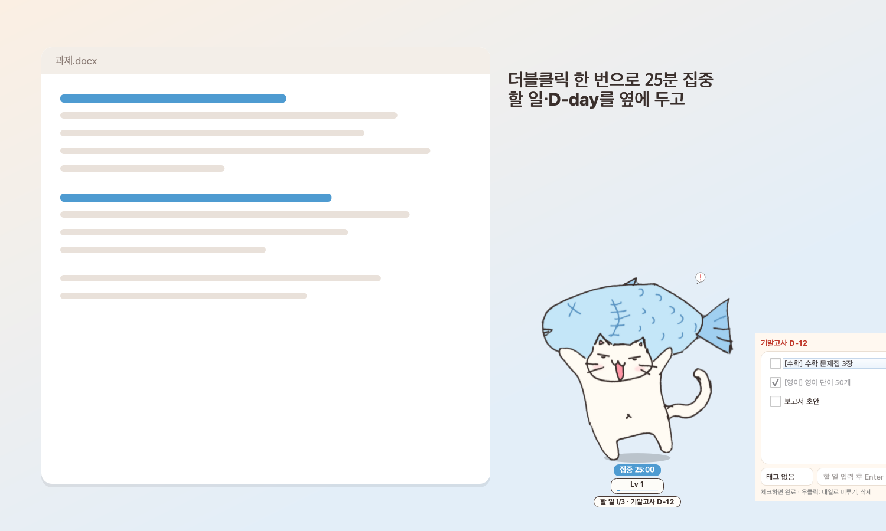

### 쉬는 시간엔 같이 놀아요
음악을 틀면 춤을 추고, 유튜브를 보면 생선을 냠냠 먹고, 책을 읽으면 옆에서 잠들어요. 집중하는 동안에는 방해하지 않아요.
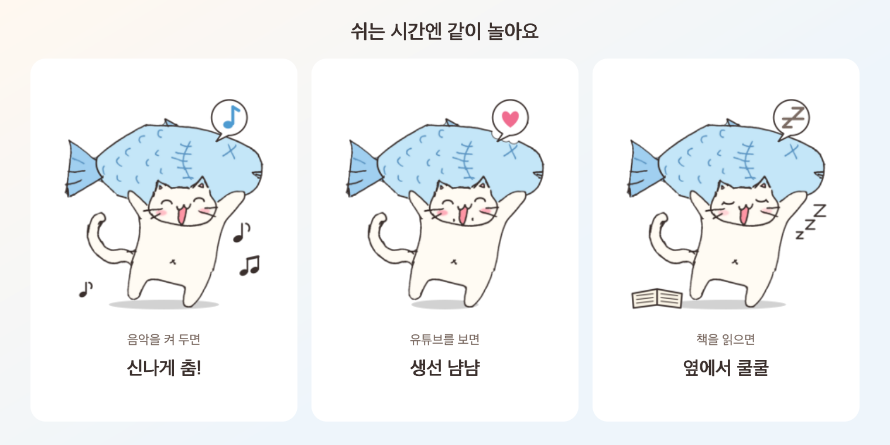

### 만지면 반응해요
톡 누르면 통통 튀고, 문지르면 쓰다듬어져요. 끌고 다니면 대롱대롱 흔들려요.
다른 창의 맨 윗줄에 올려놓으면 그 창 위를 걸어 다녀요.
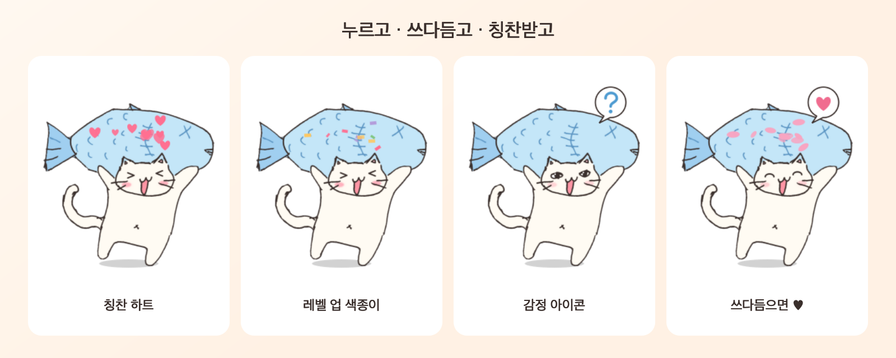

### 내 그림으로 캐릭터를 만들어요
내가 그렸거나 좋아하는 그림 파일을 넣으면 그 그림이 캐릭터가 돼요.
**설정 → 캐릭터**에서 그림을 넣어요. 배경이 투명한 그림(PNG 파일)이 가장 예뻐요.
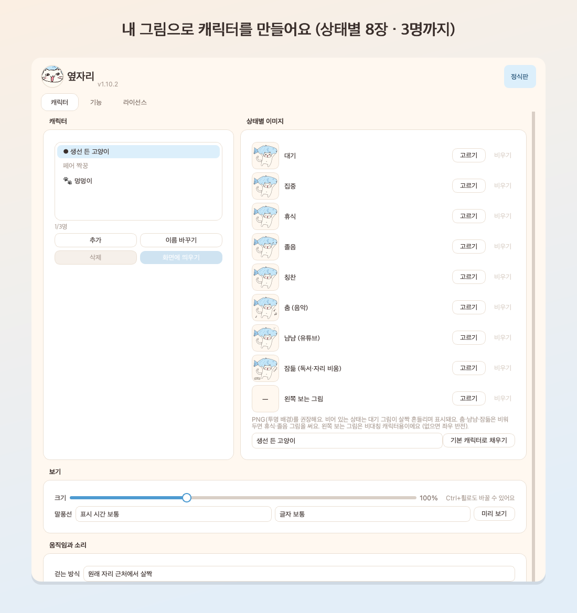

### 모자·리본으로 꾸며요
모자·리본·안경 같은 그림을 캐릭터 위에 얹을 수 있어요.
**설정 → 꾸미기**에서 그림을 넣고, 미리 보기 화면에서 끌어서 자리를 맞춰요. 마우스 휠을 굴리면 크기가 바뀌어요.
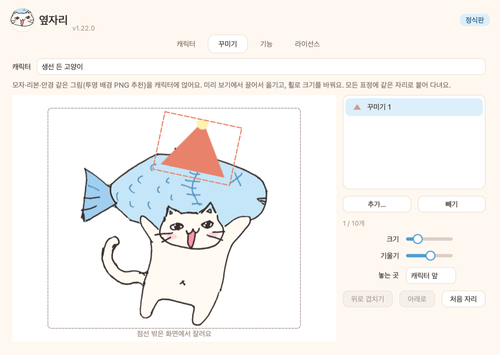

그림에 흰 배경이 붙어 있어도 괜찮아요. **배경 투명하게** 버튼을 누르면 배경만 지워 줘요. 마음에 안 들면 언제든 원래 그림으로 되돌릴 수 있어요.
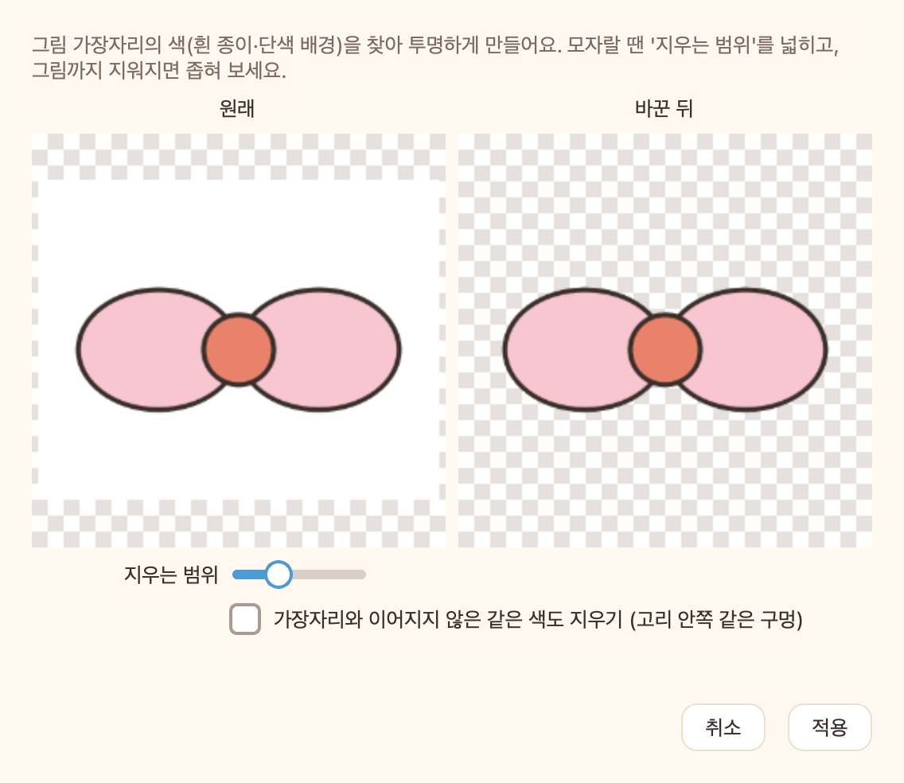

### 캐릭터 여러 명을 함께 둬요 — 그룹 *(정식판)*
캐릭터를 여러 명 띄워 둘 수 있어요. 친구·연인·라이벌·가족 같은 사이를 정해 주면 서로 주고받는 말이 달라져요.
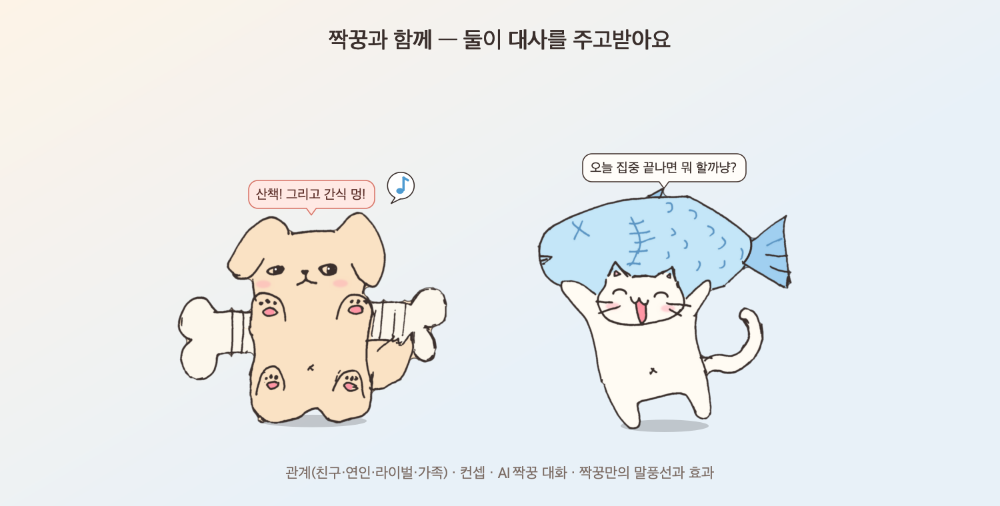

### 한 주를 정리해 줘요 (주간 리포트)
이번 주에 얼마나 공부했는지, 며칠 연속으로 했는지를 카드 한 장으로 보여 줘요.
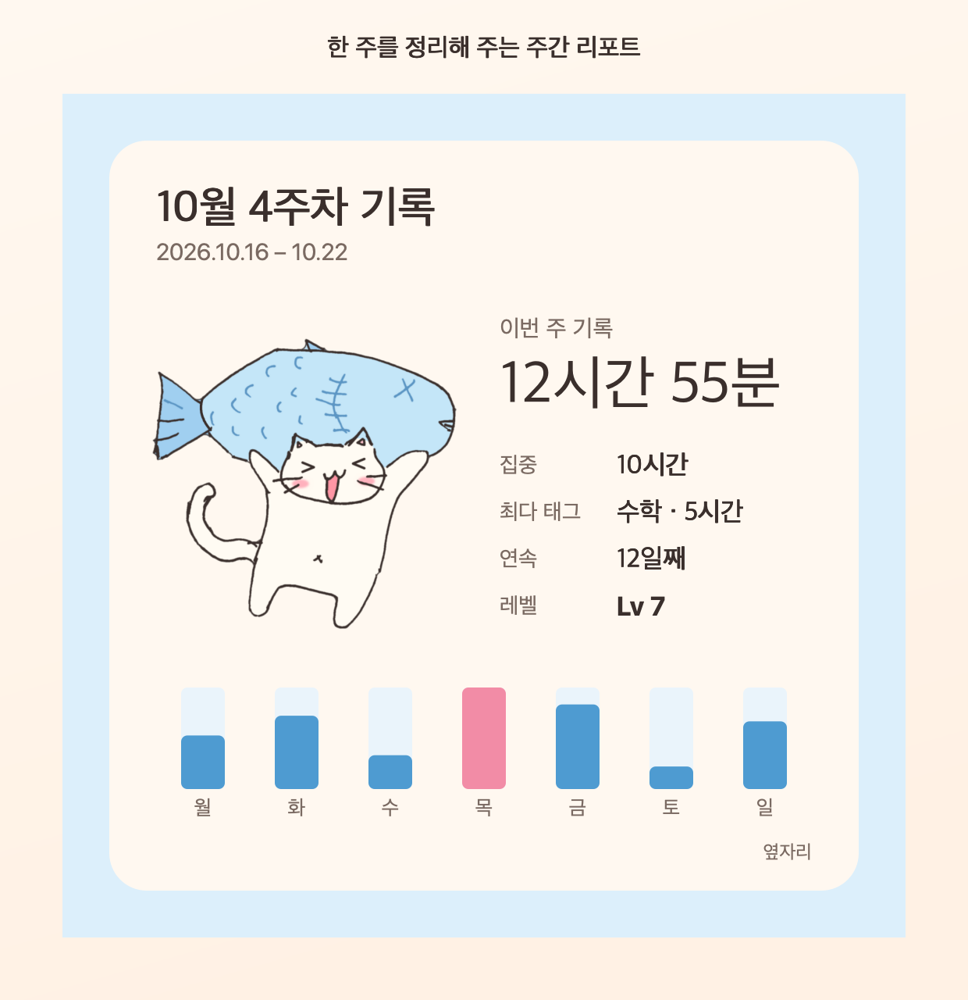

### 캐릭터가 할 말을 정해요
집중을 시작할 때, 끝냈을 때, 눌렀을 때처럼 상황마다 캐릭터가 할 말을 내가 직접 써 넣을 수 있어요.

**AI 있는 판 + 정식판**이라면 AI가 캐릭터 성격에 맞춰 대사를 대신 지어 줘요. 켜는 방법은 아래 [자주 묻는 질문](#자주-묻는-질문)에 있어요.
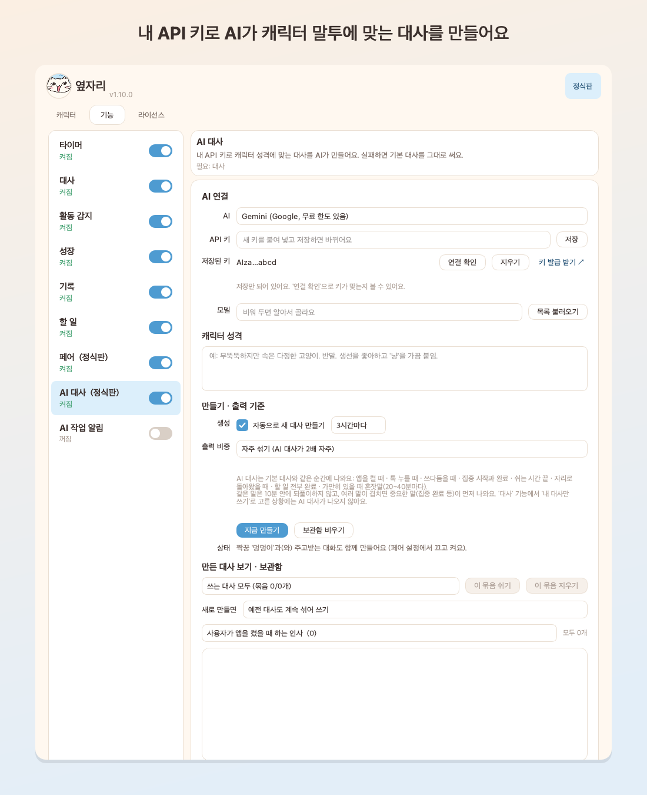

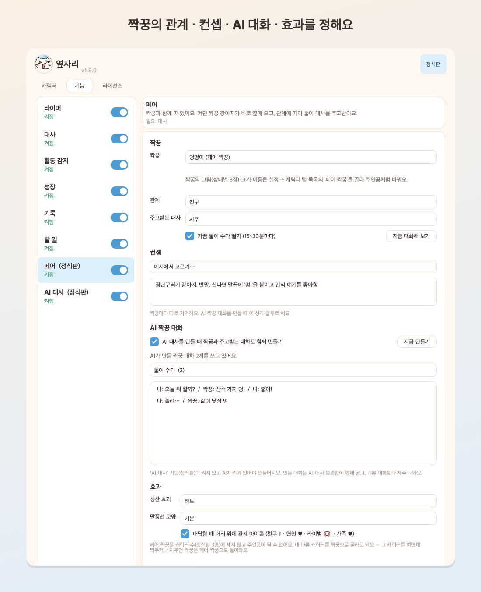

### 듣는 노래를 따라 불러요 — 음악 따라 말하기
Spotify·Apple Music·유튜브로 노래를 들으면 캐릭터가 곡을 소개하거나 가사를 따라 불러요. 외국어 가사에는 한국어 뜻도 작게 달아 줘요.
처음엔 꺼져 있어요. **설정 → 기능 → 음악 따라 말하기**에서 켜요.

### AI에게 맡긴 일을 알려 줘요 — AI 작업 알림 *(개발자용)*
Claude Code나 Codex 같은 AI 코딩 도구를 쓰는 분을 위한 기능이에요. AI가 일을 시작했는지, 끝났는지, 내 확인이 필요한지를 캐릭터가 말해 줘요.
이런 도구를 쓰지 않는다면 신경 쓰지 않아도 돼요. 처음엔 꺼져 있어요.
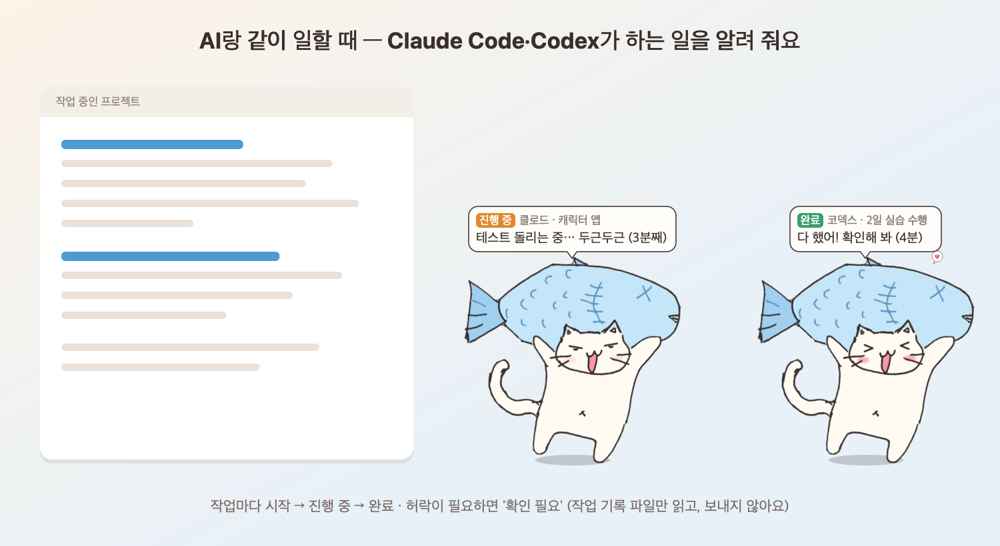

---

## 체험판과 정식판

- **체험판**: 설치하면 바로 쓰는 무료 판이에요. 기간 제한 없이 계속 쓸 수 있어요.
- **정식판**: 판매처에서 **라이선스 키**를 사서 넣으면 열려요. 프로그램을 새로 받을 필요는 없어요.
- **라이선스 키**는 정식판을 여는 글자 묶음이에요. 비밀번호처럼 생각하면 돼요.

| | 체험판 (무료) | 정식판 |
| --- | --- | --- |
| 캐릭터 수 | 1명 | 여러 명 |
| 표정 그림 | 1장 | 8장 (춤·냠냠·잠듦 포함) + 왼쪽 보는 그림 |
| 말투 | 다정한 말투 1가지 | 3가지 + 캐릭터마다 대사 고쳐 쓰기 |
| 레벨 | 10까지 | 끝없이 |
| 지난 기록 보기 | 최근 7일 | 전부 |
| 주간 리포트 | 옆자리 표시(워터마크)가 찍혀요 | 깔끔하게 |
| 일할 때 쓰는 프로그램 구분하기 | — | ○ |
| 할 일 과목 태그 · D-day | 3개 · 1개 | 제한 없음 |
| 꾸미기 그림 | 캐릭터마다 1개 | 캐릭터마다 10개 |
| 그룹(캐릭터 여러 명 함께 두기) · AI 대사 · 가사 AI 번역 | — | ○ (AI 대사·AI 번역은 AI 있는 판에서) |
| 타이머 · 쉬는 시간 놀이 · 음악 따라 말하기 · AI 작업 알림 | ○ | ○ |

체험판에서 쌓은 기록과 레벨은 정식판이 되어도 그대로 이어져요.

### 정식판 키 넣는 법

1. 캐릭터에 마우스를 올리고 **⚙**를 눌러 설정을 열어요.
2. 맨 위에서 **라이선스**를 눌러요.
3. 받은 키를 그대로 **붙여 넣고** **적용**을 눌러요. 바로 정식판으로 바뀌어요.

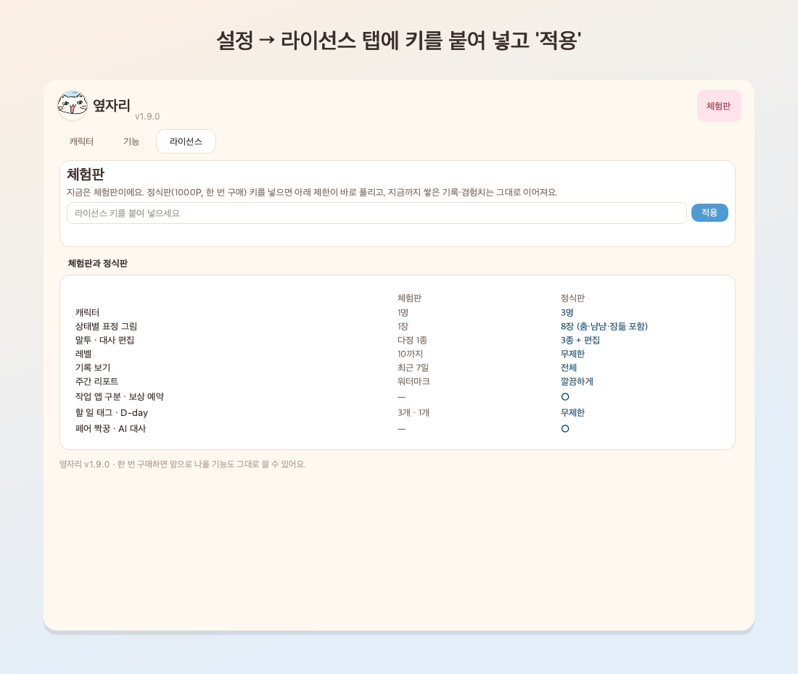

- "키가 올바르지 않아요"가 뜨면: 키 앞뒤에 빈칸이 들어가지 않게 다시 복사해서 붙여 넣어 보세요.
- "사용이 중지된 키"가 뜨면: 구매한 곳에 문의해 주세요.

---

## 새 버전으로 바꾸기 · 지우기

**새 버전으로 바꾸기**: 이 페이지에서 파일을 다시 받아 [2단계](#2단계-설치하기)를 똑같이 한 번 더 하면 돼요. 캐릭터·기록·라이선스는 그대로 남아요.
맥에서는 먼저 고양이 아이콘에서 **종료**를 누른 다음 설치하고, "대치하겠습니까?"라고 물으면 **대치**를 눌러요.

**지우기**
- 윈도우: **창문 모양(⊞) → 설정 → 앱 → 설치된 앱**(Windows 10은 **앱 및 기능**)에서 **옆자리**를 찾아 **제거**를 눌러요.
- 맥: 고양이 아이콘에서 **종료**한 다음, **응용 프로그램** 폴더의 **Yeopjari**를 휴지통으로 끌어다 놓아요.

---

## 자주 묻는 질문

질문을 누르면 답이 펼쳐져요.

<b>캐릭터가 안 보여요 / 사라졌어요</b>

[고양이 아이콘](#3단계-써-보기)을 누르고 **캐릭터 보이기**를 눌러요.
고양이 아이콘도 없다면 프로그램이 꺼진 거예요. 윈도우는 시작 메뉴에서 **옆자리**를, 맥은 응용 프로그램 폴더에서 **Yeopjari**를 다시 열어요.

<b>⚙(톱니바퀴) 버튼이 안 보여요. 설정을 어떻게 여나요?</b>

⚙는 평소엔 숨어 있다가 캐릭터에 마우스를 올리면 오른쪽 위에 나와요.
그래도 안 보이면 캐릭터를 마우스 오른쪽 버튼으로 누르거나, 고양이 아이콘을 누르고 **설정**을 고르세요.

⚙를 늘 보이게 하거나 아예 없애려면 **설정 → 캐릭터 → 움직임과 소리 → 설정 버튼 ⚙**에서 바꿔요.

<b>AI 있는 판과 AI 없는 판, 뭘 받아야 하나요?</b>

잘 모르겠으면 **AI 있는 판**(이 페이지 맨 위 표의 파일)을 받으세요. AI 기능은 내가 켜기 전에는 작동하지 않아요.
AI를 쓸 생각이 없고 화면이 단순한 게 좋으면 **AI 없는 판**을 받으세요.
라이선스 키는 같아서, 나중에 다른 판으로 바꿔 설치해도 캐릭터·기록·라이선스가 그대로 남아요.

<b>AI 대사는 어떻게 켜나요? 돈이 드나요?</b>

AI 있는 판 + 정식판에서 쓸 수 있어요. **설정 → 기능 → AI 대사**를 켜고, 쓸 AI를 하나 골라요.

| 고를 수 있는 AI | 돈 | 준비할 것 |
| --- | --- | --- |
| **Gemini** (구글) | 정해진 양까지 무료 | [Google AI Studio](https://aistudio.google.com/apikey)에서 **API 키**를 받아 붙여 넣어요 |
| **Claude** | 쓴 만큼 요금이 나가요 | [Anthropic 콘솔](https://console.anthropic.com/settings/keys)에서 **API 키**를 받아 붙여 넣어요 |
| **로컬 AI** (Ollama) | 무료 | 설정 화면에서 **Ollama 받기**를 눌러 설치하고, 추천 모델 옆의 **받기**를 눌러요 |

- **API 키**는 "이 AI를 써도 되는 사람"이라는 걸 알려 주는 글자 묶음이에요. 위 사이트에서 구글 계정 등으로 로그인하면 만들 수 있어요.
- **로컬 AI**는 인터넷의 AI 회사 대신 내 컴퓨터가 직접 대사를 짓는 방식이에요. 무료지만 컴퓨터 성능이 필요해요(메모리 8GB 이상 추천). 느린 컴퓨터에서는 한 번에 몇 분이 걸릴 수 있어요.
- 처음이라면 **Gemini**가 가장 쉬워요.

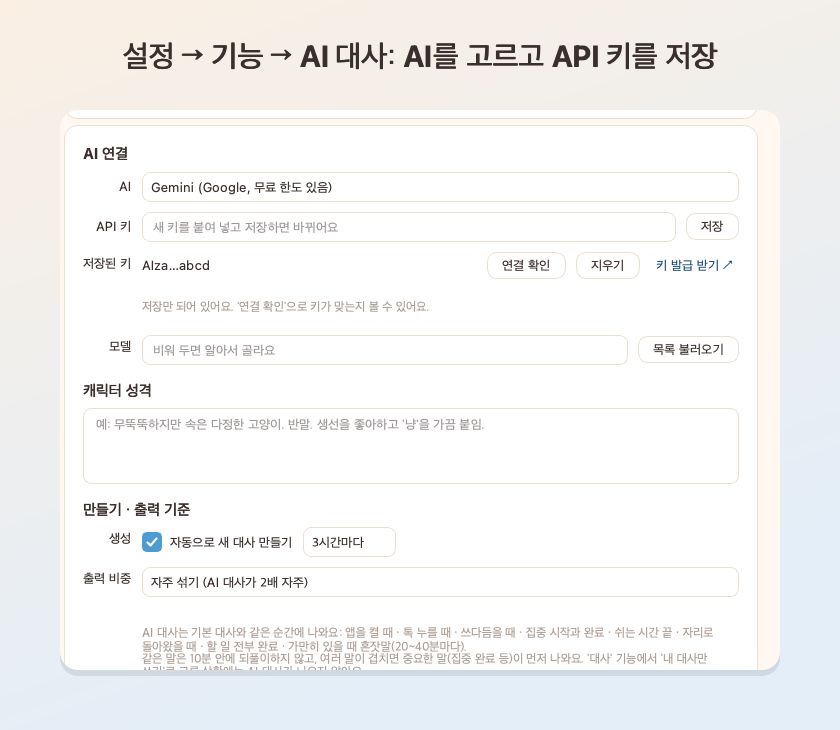

- 넣은 키는 이 컴퓨터의 안전한 보관함(맥은 키체인, 윈도우는 자격 증명 관리자)에만 저장돼요.
- AI에게 보내는 건 캐릭터 이름, 적어 둔 성격·말투, 오늘 집중한 시간과 연속 일수예요. 내가 키보드로 친 내용, 화면, 할 일 내용은 보내지 않아요.
- AI가 잠깐 안 되어도 캐릭터는 기본 대사로 계속 말해요.

<b>쉬는 시간에 춤·냠냠·잠을 안 하게 하고 싶어요</b>

**설정 → 기능 → 활동 감지 → 쉬는 시간 놀이**에서 전부 끄거나 하나씩 끌 수 있어요.

- 음악 프로그램이 켜져 있으면 노래를 멈춰 둔 상태여도 춤을 춰요.
- 맥에서 유튜브를 알아보려면, 처음 한 번 뜨는 "옆자리가 Chrome(또는 Safari)을 제어하려고 합니다" 창에서 **허용**을 눌러 주세요. Firefox에서는 알아볼 수 없어요.

<b>함께 있는 캐릭터의 그림이나 이름을 바꾸고 싶어요</b>

**설정 → 캐릭터**의 목록에서 그 캐릭터를 고르면 그림·크기·이름을 바꿀 수 있어요.
서로의 사이·성격·말하는 횟수는 **설정 → 기능 → 그룹**에서 정해요.

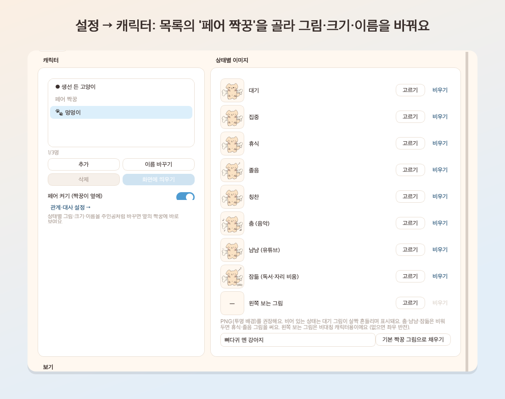

<b>맥에서 열리지 않아요 (Intel 맥)</b>

지금은 M1 이후 칩이 들어간 맥만 쓸 수 있어요. Intel 칩 맥은 준비 중이에요.
내 맥이 어느 쪽인지는 왼쪽 위 **사과 모양 → 이 Mac에 관하여**에서 볼 수 있어요.

<b>맥에서 "키체인 암호"를 넣으라는 창이 떠요</b>

AI 대사에 쓰는 API 키를 맥의 보관함(키체인)에서 꺼낼 때 맥이 확인하는 창이에요.
맥을 켤 때 쓰는 암호를 넣고 **항상 허용**을 누르면 다음부터는 묻지 않아요. 암호는 옆자리가 아니라 맥이 직접 받아요.

<b>옆자리가 내 컴퓨터에서 뭘 보나요? (개인정보)</b>

**보지 않는 것**: 키보드로 친 내용, 화면에 보이는 내용.

**보는 것** (쉬는 시간 놀이 등을 위해)
- 마지막으로 키보드·마우스를 쓴 뒤 시간이 얼마나 지났는지
- 지금 맨 앞에 떠 있는 프로그램의 이름 (이 기능을 켠 경우)
- 켜져 있는 음악 프로그램의 이름
- 인터넷 창의 맨 앞 탭이 유튜브인지

**기록은 어디에 남나요?** 내 컴퓨터 안에만 저장돼요. 어디로도 보내지 않아요.
(맥은 `~/Library/Application Support/Yeopjari`, 윈도우는 `%APPDATA%\Yeopjari` 폴더)

**인터넷을 쓰는 경우**
- 하루 한 번, 사용이 중지된 라이선스 키 목록을 받아 와요. 내 정보를 보내지는 않아요.
- AI 대사를 켰을 때: 고른 AI에 대사를 부탁해요. 로컬 AI는 내 컴퓨터 안에서만 돌아가요.
- 음악 따라 말하기를 켰을 때: 가사 사이트(lrclib.net 등)에 곡 정보를 보내고, 번역 서비스에 외국어 가사를 보내요.
- AI 작업 알림을 켰을 때: Claude Code·Codex가 내 컴퓨터에 남기는 작업 기록 파일의 새 줄만 읽어요. 읽은 내용은 저장하거나 보내지 않아요.

<b>문제가 생기면 어디에 알리나요?</b>

구매한 곳의 문의 창구로 알려 주세요. 아래 내용을 함께 보내 주시면 빨리 도울 수 있어요.
- 옆자리 버전 (설정 창 위쪽에 적혀 있어요)
- 윈도우인지 맥인지
- 무엇을 하다가 생겼는지
- 기록 파일: 맥은 `~/Library/Application Support/Yeopjari/logs/app.log`, 윈도우는 `%APPDATA%\Yeopjari\logs\app.log`

<b>받은 파일이 진짜인지 확인하고 싶어요 (버전 · 체크섬)</b>

이 페이지의 받기 링크는 늘 가장 새 버전을 받아요. 버전 번호와 파일 확인용 값(SHA256)은 [릴리스 페이지](https://github.com/sendtoyj00/yeopjari-download/releases/latest)에 적혀 있어요.

---

## 낱말 풀이

| 낱말 | 뜻 |
| --- | --- |
| 설치 파일 | 프로그램을 컴퓨터에 넣어 주는 파일. 이름이 `.exe`(윈도우)나 `.dmg`(맥)로 끝나요 |
| 더블클릭 | 마우스 왼쪽 버튼을 빠르게 두 번 누르기 |
| 우클릭 | 마우스 오른쪽 버튼 누르기. 맥 트랙패드에서는 두 손가락으로 누르기 |
| 끌어다 놓기 | 마우스 버튼을 누른 채로 옮긴 다음 손을 떼기 |
| 라이선스 키 | 정식판을 여는 글자 묶음 |
| API 키 | AI 서비스를 쓸 때 넣는 글자 묶음. AI 대사를 쓸 때만 필요해요 |
| 체험판 · 정식판 | 무료로 쓰는 판 · 키를 넣어 모든 기능을 여는 판 |

---

이 저장소에는 설치 파일과 소개 자료만 있어요. 프로그램 소스 코드는 공개하지 않아요.
라이선스 구매·환불·문의는 판매처로 연락해 주세요.
